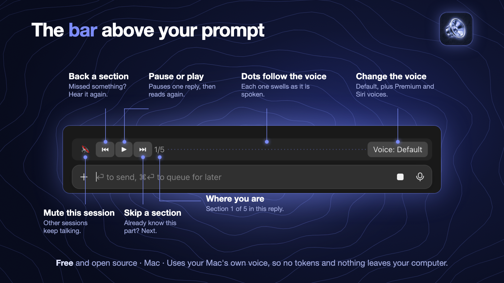

# auto-voice

A Claude Code mod that reads Claude's replies aloud as they appear, so you never have to click a speaker button.



- **Every reply, read aloud** section by section, while Claude is still working.
- **A small bar above the prompt:** 🔊 ⏮ ⏸/▶ ⏭, a section counter such as `2/3`, a row of dots that pulse with the voice, and the voice name.
- **⏮ / ⏭** move between sections of a reply, then on to the previous or next reply.
- **⏸ / ▶** pause and resume. Pausing lasts one reply, so your next message is read again. After a reply has finished, ▶ reads it again from the start.
- **🔊 / 🔇** mute the whole session, across replies, until you press it again. Other sessions keep talking.
- **Voice: Default** cycles through your Mac's default voice and any natural Premium, Enhanced or Siri voices you have installed. If you have fewer than four, a one-time **Get natural voices** tip opens the right settings page.
- **When Claude asks a question,** the bar steps aside for the question box and a short line under the prompt shows what the voice is doing.

It uses your Mac's built-in voice, so it costs no tokens and sends nothing anywhere.

## Requirements

- macOS (it uses the built-in `say` voice).
- Claude Code with mods, in the terminal or the desktop app's Code tab.
- Optional: `python3`, which comes with Apple's command line tools. The dots use it to measure the voice. Without it, the dots follow an estimate of the words instead.

## Install

At the prompt of a Claude Code terminal session:

```
/plugin install auto-voice --marketplace stha-hardik/claude-mod-auto-voice
```

From a shell:

```bash
claude plugin install auto-voice --marketplace stha-hardik/claude-mod-auto-voice
```

In the desktop app, where `/plugin` does not run: click + next to the prompt box, then Plugins, Add marketplace with `stha-hardik/claude-mod-auto-voice`, then Add plugin.

Answer `y` to add the marketplace, then pick the user scope so it works in every session. Open a new chat afterwards.

## Get updates

New mods and updates first, by email: [Hardik Shrestha](https://shresthahardik.substack.com)

## Better voices

Apple's natural voices are free. Open **System Settings → Accessibility → Read & Speak** (called Spoken Content on older macOS), click the **(i)** next to **System Voice**, then **Manage Voices**, and download English voices marked **Premium** or **Enhanced**. auto-voice picks them up in your next session.

## Settings

The starting voice can also be set in the config menu, under **auto-voice → Voice**.

## Licence

MIT. See [LICENSE](LICENSE).
